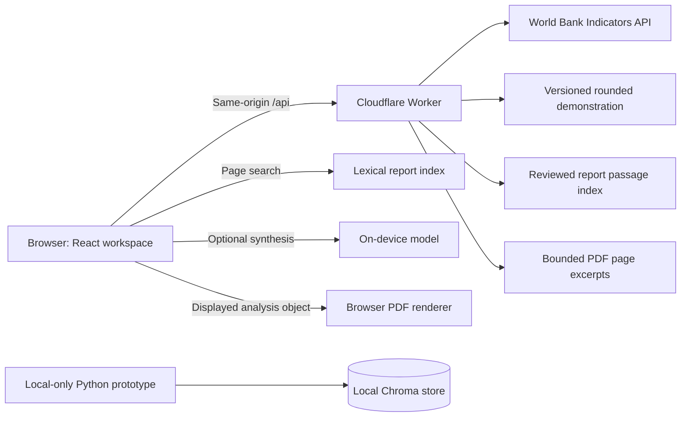

# Global Economic Intelligence Agent

An economic research workspace that asks: **What is happening in this economy, what evidence supports it, and what deserves closer attention?** The public app is React and TypeScript with a Cloudflare Worker API. It starts with a dated, genuine-data demonstration and offers a live World Bank mode.

[Nicholai Gay's AI engineering portfolio](https://profile.nickcloud.dev/) · [LinkedIn](https://www.linkedin.com/in/nicholai-gay-201905148/) · [CI status](https://github.com/QinnniQ/global-economic-intelligence-agent/actions/workflows/ci.yml)


**Release status, 21 October 2026:** [econ.nickcloud.dev](https://econ.nickcloud.dev/?view=sources) lists 13 official reports, including six 2026 editions. The local Chroma collection contains 9,317 chunks. The public analyst offers report page retrieval and optional on-device generation without a paid model API. See [the public report mode](docs/PUBLIC_RAG.md) for its limits and verification.

## Visitor experience

- Explore GDP growth, consumer-price inflation and modeled ILO unemployment for the Netherlands, Germany, France, the United Kingdom and the United States.
- Use a clearly labelled saved demonstration without any credentials. Live mode retrieves full annual World Bank series.
- Compare two to four countries across a chosen indicator and date window, with an aligned chart, table, common observation year and shareable URL.
- Ask a single-country question and inspect source-linked findings, relevant page-linked report passages and explicit limitations.
- Search pages across all 13 source PDFs, then open a matching page at the publisher. The library also shows file fingerprints and index counts.
- Export the **displayed** analysis as a PDF in the browser. Export never reruns retrieval or analysis.

The observed-data analyst is deterministic. Its two-passage report index is curated retrieval. The public Report RAG mode searches a lexical page index over all 13 PDFs, displays short page-linked excerpts, and optionally generates a synthesis in the visitor's browser. It does not use a server-side vector store or the local Chroma collection. Generation requires WebGPU and an approximately 117 MB first-use model download. The Python and Streamlit prototype remains local and is not part of the Cloudflare deployment. Its Chroma vectors use Chroma's explicit local default embedding function. The six 2026 editions have per-chunk PDF page metadata; the seven original editions retain their legacy chunks without pages.

The Source library and Report RAG share a lexical page index with publisher PDF links. Full extracted page text is accessible only to the Worker; its API returns bounded excerpts. Report RAG does not change observed-data findings.

Reliability checks are described in [operations](docs/OPERATIONS.md): partial live findings label missing indicators; a scheduled Worker probe and external public monitor test representative series; weekly checks flag saved-value revisions and new official report links for review. The checks do not publish revised values or reports automatically.

## Run and verify

```bash
cd web
npm ci
npm run dev
```

Open the URL printed by Vite, normally `http://127.0.0.1:5173`. The saved demonstration needs no credentials. Live mode needs outbound access to `api.worldbank.org`.

```bash
cd web
npm test
npm run build
```

The legacy Python prototype can still be started with `docker compose up --build` after copying `.env.example` to `.env` and supplying an `OPENAI_API_KEY`. It is experimental and may incur model charges if used. Ingestion is disabled unless `INGEST_ADMIN_TOKEN` is set, and Compose binds the legacy services to localhost. Its raw model endpoints must **not** be exposed publicly. The 384-dimensional Chroma vectors use the local default ONNX MiniLM embedding function, now explicitly set for ingestion and retrieval in [rag_store.py](src/backend/rags/rag_store.py). The [report manifest](data/report_manifest.json) records source URLs, pages and file hashes; [ingest_reports.py](scripts/ingest_reports.py) adds missing chunks and preserves existing IDs. Use [verify_chroma_vectors.py](scripts/verify_chroma_vectors.py) against a copy of the store to inspect one ID or all vectors. Page metadata is available for the six newly ingested editions; the legacy seven would need rebuilding to gain it. The [offline analysis trace](docs/offline_trace.md) uses stubbed evidence and no API key.

## Architecture



The Worker needs no database or persistent filesystem. Its static assets and API deploy together. The Chroma directory is a persistent **local** artifact; it has not been migrated to Cloudflare Vectorize. See the [architecture walkthrough](docs/ARCHITECTURE.md) and [API contract](docs/API.md). Cloudflare's [React/Worker tutorial](https://developers.cloudflare.com/workers/vite-plugin/tutorial/) and [Cache API documentation](https://developers.cloudflare.com/workers/runtime-apis/cache/) inform this design.

## Data and evidence

The Worker accepts only five country codes and three indicator IDs. Live requests include a bounded date range. The adapter asks World Bank for up to 1,000 rows per page, checks response shape, fetches reported pages (up to 20), rejects inconsistent pagination, drops null and malformed values without substituting zero, and records retrieval and provider-update timestamps. Each request attempt times out after eight seconds and receives at most one retry for a temporary failure. Live series are cached for six hours in Cloudflare's data-centre-local cache. An upstream failure is displayed as an error with retry and saved-demo controls; stale values are not silently substituted. The Worker exposes `/api/health`, which checks only the app handler.

[Indicator definitions and units](web/src/domain.ts) distinguish GDP growth from GDP level and inflation from the CPI level. Changes between annual rates are reported in **percentage points**. Observation year is separate from retrieval date. The latest year may differ by country or indicator.

The [saved demonstration](web/src/demoSnapshot.json) contains World Bank values rounded to one decimal: 2024 GDP growth and inflation, and 2025 modeled unemployment. They were transcribed from official [Netherlands/Germany/France](https://data.worldbank.org/?locations=BE-NL-LU-DE-FR-IT) and [United Kingdom/Germany/United States/France](https://data.worldbank.org/?locations=GB-DE-US-FR) pages reviewed on 15 October 2026. The provider may revise those pages. The saved demo has **one observation per series** and cannot establish a trend.

The hosted [report index](web/worker/reports.ts) has two short passages reviewed against repository PDFs: ECB *Economic Bulletin* Issue 7 / 2025, page 11, and OECD *Interim Economic Outlook* September 2025, page 13. Stable passage IDs, title, publisher, official link, publication date, page, checksum and ingestion version are recorded. Retrieval requires matching geography and topic. Report excerpts are dated context, not validation of World Bank values. Numerical findings cite only the series used, and citation IDs are checked in code. Missing relevant passages are disclosed.

## Privacy and limits

The public app has no client-side credentials or public ingestion. Report questions go to the same-origin Worker for bounded excerpt selection; optional generation runs in the visitor's browser. No OpenAI or Workers AI model call is made. Model files download from Hugging Face only after the visitor requests generation. React renders external text safely. API inputs are bounded and a per-isolate request guard limits bursts. Structured failure logs contain request ID, route, status and error type, not question text.

This release has five countries and three indicators. The observed-data analyst report index is curated; Report RAG provides lexical retrieval across the 13 PDFs with PDF page links. Retrieval can miss the best passage and the small optional model can make unsupported claims. It does not support EU or euro-area aggregates, multi-country observed-data analyst questions or forecasts. Annual series and report dates can lag economic events. The observed-data PDF uses standard Helvetica and ASCII-normalised text for portability.

## Evaluation

`web/tests/product.test.ts` covers country aliases and ambiguity, null and zero values, pagination and drift, mixed years, percentage-point changes, upstream failure, report relevance and malicious input, citation IDs, health, API errors, and concurrent isolated PDFs. The [ten-question evaluation set](web/eval/questions.v1.json) defines evidence expectations and a human assessment rubric. Automated checks assess structure and arithmetic; human review is required for claim support and interpretation.

Checked locally on 20 October 2026: **18 web tests passed** and the TypeScript/Vite production build passed. `python -m pytest` could not run because this environment lacks `pytest`. No accuracy, latency or accessibility score is claimed. See the [verification record](docs/VERIFICATION.md) for real versus mocked checks.

The 20 October reliability and page-search update passed **23 web tests** and a production build. Its separate 30-case page-search set verifies report discoverability and unrelated-query abstention, not claim accuracy. Preview browser checks and deployment details are in [verification](docs/VERIFICATION.md).

After the preview deployment, browser checks confirmed `/api/health`, saved analysis and three-country comparison, live Netherlands series and analyst answer, and a PDF download. A 390×844 mobile viewport showed usable comparison controls and a readable saved briefing. After approved production deployment, the custom domain's health, saved analyst, live overview and live analyst were checked successfully. An earlier production live request had failed; the live branch should be rechecked immediately before an interview demo.

## Cloudflare deployment

[wrangler.jsonc](web/wrangler.jsonc) defines separate preview and production Worker names. The production Worker serves [econ.nickcloud.dev](https://econ.nickcloud.dev) as a Cloudflare Custom Domain and retains its [workers.dev URL](https://global-economic-intelligence.nicholai-gay.workers.dev). The [preview Worker](https://global-economic-intelligence-preview.nicholai-gay.workers.dev) has its own `workers.dev` URL. The existing `infernomics.nickcloud.dev` site remains untouched. No secret or paid service is required. For a fresh checkout or redeployment, from `web/`:

```bash
npx wrangler login
npm run deploy:preview
# Open the printed workers.dev URL and check overview, compare, analyst and PDF.
# Switch to Live data and verify a Netherlands series and timestamps.
npm run deploy:production
```

The scripts select the Cloudflare environment, build assets and Worker together, verify the intended Worker name, and deploy the generated configuration. The production configuration attaches only `econ.nickcloud.dev`; Cloudflare manages its DNS and certificate. This review deployed preview, then production after approval. Roll back the named Worker via its Cloudflare **Deployments** page or `npx wrangler rollback --name global-economic-intelligence` after selecting the previous version. See Cloudflare's [rollback instructions](https://developers.cloudflare.com/workers/versions-and-deployments/rollbacks/).

The app needs no paid model, D1, R2 or Vectorize, and renders briefing PDFs in the browser to avoid Worker PDF CPU cost. Normal Cloudflare hosting usage still follows the account plan; this release adds no paid inference service. See [current Cloudflare pricing](https://developers.cloudflare.com/workers/platform/pricing/) before operating at scale.

## Additional material

- [Engineering case study](docs/engineering-case-study.md)
- [Architecture](docs/ARCHITECTURE.md) · [API contract](docs/API.md) · [Engineering decisions](docs/ENGINEERING_DECISIONS.md)
- [Three-minute demo script](docs/DEMO_SCRIPT.md) · [Interview preparation](docs/INTERVIEW_PREP.md) · [Verification record](docs/VERIFICATION.md)
- [Earlier 60–90 second demo script](docs/demo-script.md)
- [CV and LinkedIn wording](docs/portfolio-copy.md)
- [Versioned evaluation set](web/eval/questions.v1.json)
- [Legacy offline analysis trace](docs/offline_trace.md)
