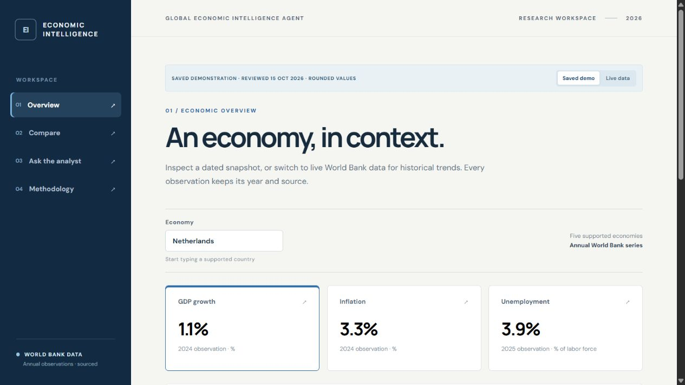
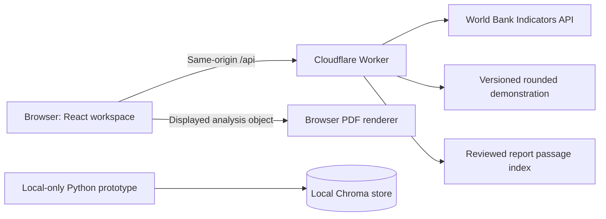

# Global Economic Intelligence Agent

An economic research workspace that asks: **What is happening in this economy, what evidence supports it, and what deserves closer attention?** The public app is React and TypeScript with a Cloudflare Worker API. It starts with a dated, genuine-data demonstration and offers a live World Bank mode.

[Nicholai Gay's AI engineering portfolio](https://profile.nickcloud.dev/) · [LinkedIn](https://www.linkedin.com/in/nicholai-gay-201905148/) · [CI status](https://github.com/QinnniQ/global-economic-intelligence-agent/actions/workflows/ci.yml)



**Release status, 20 October 2026:** the updated application is deployed at [econ.nickcloud.dev](https://econ.nickcloud.dev/?view=sources). Production version: `e2069b89-d01a-4779-a591-a315256ef698`; preview version: `b8e02e8b-c803-42c3-979c-94395032e5b4`. The new Source library was inspected on both domains, and all seven publisher PDF links appeared in the production page. Earlier browser checks covered health, saved analysis, live Netherlands observations, comparison, mobile layout and PDF export. Provider availability should be rechecked before a demo. No paid model service is configured. See [verification](docs/VERIFICATION.md) for the exact scope of each check.

## Visitor experience

- Explore GDP growth, consumer-price inflation and modeled ILO unemployment for the Netherlands, Germany, France, the United Kingdom and the United States.
- Use a clearly labelled saved demonstration without any credentials. Live mode retrieves full annual World Bank series.
- Compare two to four countries across a chosen indicator and date window, with an aligned chart, table, common observation year and shareable URL.
- Ask a single-country question and inspect source-linked findings, relevant page-linked report passages and explicit limitations.
- Open all seven reports from the Source library, with publisher PDF links, local file fingerprints and original index counts.
- Export the **displayed** analysis as a PDF in the browser. Export never reruns retrieval or analysis.

The public analyst is deterministic. It makes no paid model calls, forecasts, causal claims or personalized investment recommendations. The two-passage report index is **curated retrieval, not semantic vector RAG**. The Python and Streamlit prototype remains local and is not part of the Cloudflare deployment. Its Chroma vectors have been checked against Chroma's local default embedding function; the index does not retain per-chunk PDF page metadata.

## Run and verify

```bash
cd web
npm ci
npm run dev
```

Open the URL printed by Vite, normally `http://127.0.0.1:5173`. The saved demonstration needs no credentials. Live mode needs outbound access to `api.worldbank.org`.

```bash
cd web
npm test
npm run build
```

The legacy Python prototype can still be started with `docker compose up --build` after copying `.env.example` to `.env` and supplying an `OPENAI_API_KEY`. It is experimental and may incur model charges if used. Ingestion is disabled unless `INGEST_ADMIN_TOKEN` is set, and Compose binds the legacy services to localhost. Its raw model endpoints must **not** be exposed publicly. The existing `chroma_store` must not be claimed as OpenAI-embedded: `rag_store.py` creates `OpenAIEmbeddings` but never passes it into Chroma. The stored 384-dimensional vectors match the Chroma default local MiniLM embedding function when recomputed from their documents. Use [the vector verification script](scripts/verify_chroma_vectors.py) against a copy of the store to inspect one ID or all vectors. Rebuild a versioned index with explicit embedding configuration and page metadata before using it in the public app. The [offline analysis trace](docs/offline_trace.md) uses stubbed evidence and no API key.

## Architecture



The Worker needs no database or persistent filesystem. Its static assets and API deploy together. The existing Chroma directory is a persistent **local** artifact; no Vectorize migration or reindex is claimed. See the [architecture walkthrough](docs/ARCHITECTURE.md) and [API contract](docs/API.md). Cloudflare's [React/Worker tutorial](https://developers.cloudflare.com/workers/vite-plugin/tutorial/) and [Cache API documentation](https://developers.cloudflare.com/workers/runtime-apis/cache/) inform this design.

## Data and evidence

The Worker accepts only five country codes and three indicator IDs. Live requests include a bounded date range. The adapter asks World Bank for up to 1,000 rows per page, checks response shape, fetches reported pages (up to 20), rejects inconsistent pagination, drops null and malformed values without substituting zero, and records retrieval and provider-update timestamps. Each request attempt times out after eight seconds and receives at most one retry for a temporary failure. Live series are cached for six hours in Cloudflare's data-centre-local cache. An upstream failure is displayed as an error with retry and saved-demo controls; stale values are not silently substituted. The Worker exposes `/api/health`, which checks only the app handler.

[Indicator definitions and units](web/src/domain.ts) distinguish GDP growth from GDP level and inflation from the CPI level. Changes between annual rates are reported in **percentage points**. Observation year is separate from retrieval date. The latest year may differ by country or indicator.

The [saved demonstration](web/src/demo.ts) contains World Bank values rounded to one decimal: 2024 GDP growth and inflation, and 2025 modeled unemployment. They were transcribed from official [Netherlands/Germany/France](https://data.worldbank.org/?locations=BE-NL-LU-DE-FR-IT) and [United Kingdom/Germany/United States/France](https://data.worldbank.org/?locations=GB-DE-US-FR) pages reviewed on 15 October 2026. The provider may revise those pages. The saved demo has **one observation per series** and cannot establish a trend.

The hosted [report index](web/worker/reports.ts) has two short passages reviewed against repository PDFs: ECB *Economic Bulletin* Issue 7 / 2025, page 11, and OECD *Interim Economic Outlook* September 2025, page 13. Stable passage IDs, title, publisher, official link, publication date, page, checksum and ingestion version are recorded. Retrieval requires matching geography and topic. Report excerpts are dated context, not validation of World Bank values. Numerical findings cite only the series used, and citation IDs are checked in code. Missing relevant passages are disclosed.

## Privacy and limits

The public app stores no prompts or PDFs. It has no client-side credentials, paid inference, public ingestion or file upload. React renders external text safely. API inputs are bounded. A small per-isolate request guard reduces rapid repeated calls; it is **not** a global rate limit. Configure an account-level Cloudflare rate limiting rule for `/api/*` before high-traffic promotion. Structured failure logs contain request ID, route, status and error type, not question text.

This release has five countries and three indicators. Its report index is curated rather than a general search corpus. It does not support EU or euro-area aggregates, multi-country analyst questions, forecasts or live LLM synthesis. Annual series and report dates can lag economic events. The PDF uses standard Helvetica and ASCII-normalised text for portability.

## Evaluation

`web/tests/product.test.ts` covers country aliases and ambiguity, null and zero values, pagination and drift, mixed years, percentage-point changes, upstream failure, report relevance and malicious input, citation IDs, health, API errors, and concurrent isolated PDFs. The [ten-question evaluation set](web/eval/questions.v1.json) defines evidence expectations and a human assessment rubric. Automated checks assess structure and arithmetic; human review is required for claim support and interpretation.

Checked locally on 20 October 2026: **18 web tests passed** and the TypeScript/Vite production build passed. `python -m pytest` could not run because this environment lacks `pytest`. No accuracy, latency or accessibility score is claimed. See the [verification record](docs/VERIFICATION.md) for real versus mocked checks.

After the preview deployment, browser checks confirmed `/api/health`, saved analysis and three-country comparison, live Netherlands series and analyst answer, and a PDF download. A 390×844 mobile viewport showed usable comparison controls and a readable saved briefing. After approved production deployment, the custom domain's health, saved analyst, live overview and live analyst were checked successfully. An earlier production live request had failed; the live branch should be rechecked immediately before an interview demo.

## Cloudflare deployment

[wrangler.jsonc](web/wrangler.jsonc) defines separate preview and production Worker names. The production Worker serves [econ.nickcloud.dev](https://econ.nickcloud.dev) as a Cloudflare Custom Domain and retains its [workers.dev URL](https://global-economic-intelligence.nicholai-gay.workers.dev). The [preview Worker](https://global-economic-intelligence-preview.nicholai-gay.workers.dev) has its own `workers.dev` URL. The existing `infernomics.nickcloud.dev` site remains untouched. No secret or paid service is required. For a fresh checkout or redeployment, from `web/`:

```bash
npx wrangler login
npm run deploy:preview
# Open the printed workers.dev URL and check overview, compare, analyst and PDF.
# Switch to Live data and verify a Netherlands series and timestamps.
npm run deploy:production
```

The scripts select the Cloudflare environment, build assets and Worker together, verify the intended Worker name, and deploy the generated configuration. The production configuration attaches only `econ.nickcloud.dev`; Cloudflare manages its DNS and certificate. This review deployed preview, then production after approval. Roll back the named Worker via its Cloudflare **Deployments** page or `npx wrangler rollback --name global-economic-intelligence` after selecting the previous version. See Cloudflare's [rollback instructions](https://developers.cloudflare.com/workers/versions-and-deployments/rollbacks/).

The app needs no paid model, D1, R2 or Vectorize, and renders PDFs in the browser to avoid Worker PDF CPU cost. Check [current Cloudflare pricing](https://developers.cloudflare.com/workers/platform/pricing/) before operating at scale. No paid service has been enabled.

## Additional material

- [Engineering case study](docs/engineering-case-study.md)
- [Architecture](docs/ARCHITECTURE.md) · [API contract](docs/API.md) · [Engineering decisions](docs/ENGINEERING_DECISIONS.md)
- [Three-minute demo script](docs/DEMO_SCRIPT.md) · [Interview preparation](docs/INTERVIEW_PREP.md) · [Verification record](docs/VERIFICATION.md)
- [Earlier 60–90 second demo script](docs/demo-script.md)
- [CV and LinkedIn wording](docs/portfolio-copy.md)
- [Versioned evaluation set](web/eval/questions.v1.json)
- [Legacy offline analysis trace](docs/offline_trace.md)
