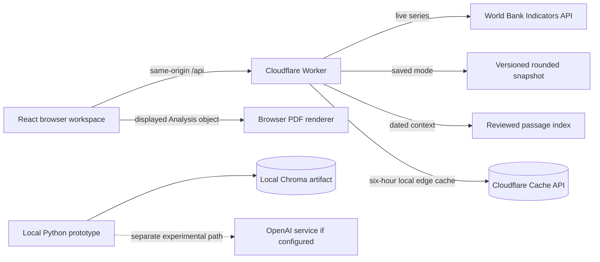

# Architecture as implemented

## Public application

The public application is one React/TypeScript single-page app (`web/src/main.tsx`) and one TypeScript Cloudflare Worker (`web/worker/index.ts`). Vite builds both; `web/wrangler.jsonc` names separate preview and production Workers. The browser calls relative `/api/*` routes on the same host. There is no public Python service, database, autonomous agent, vector store, or model call. This version is live on [econ.nickcloud.dev](https://econ.nickcloud.dev) and the [preview Worker](https://global-economic-intelligence-preview.nicholai-gay.workers.dev). A checkout's uncommitted changes are not live until deployed.

## One request, end to end

In live mode, the visitor selects a country and indicator. React calls `GET /api/series`. The Worker checks the allowed country, indicator and date window, checks its cache, then `web/worker/worldbank.ts` requests the official World Bank Indicators API. The adapter validates the response shape and pagination, excludes null or malformed observations, sorts by observation year and records the provider's `lastupdated` date when present. The Worker returns a typed `Series` containing source URL, unit, retrieval time and observations. React renders a chart and a numeric table. The table is the chart alternative.

For `POST /api/analysis`, the Worker resolves the selected country and supported topics, retrieves the necessary series, then `web/worker/analysis.ts` computes findings and percentage-point changes in deterministic code. `web/worker/reports.ts` optionally attaches passages from a two-entry, manually reviewed index. The report text is contextual evidence and does not validate indicator values. The browser exports the **same displayed Analysis object** via `web/worker/pdf.ts`; export does not call the API again.

## Responsibilities and trust boundaries

| Responsibility | Implemented in | External call or persistence |
| --- | --- | --- |
| Input validation and API transport | `web/worker/index.ts` | No persistence |
| Observation retrieval and validation | `web/worker/worldbank.ts` | HTTPS World Bank API |
| Numerical calculations and findings | `web/src/domain.ts`, `web/worker/analysis.ts` | None |
| Report ingestion | Manual review of `data/reports_pdfs/ecb.pdf` and `oecd.pdf`; metadata checked into `web/worker/reports.ts` | No runtime ingestion |
| Report retrieval | `web/worker/reports.ts` | In-bundle geography, topic and term filter; **not semantic/vector search** |
| Model synthesis | Not configured in the public Worker | No public model or embedding calls |
| Caching | `web/worker/index.ts` | Cloudflare Cache API; six-hour TTL, data-centre local and disposable |
| Presentation and PDF | `web/src/main.tsx`, `web/worker/pdf.ts` | Browser only |

The response distinguishes **observation year**, optional **World Bank provider update date**, **retrieval time**, **report publication date**, and the **15 October 2026 saved snapshot review date**. A cached response retains its original retrieval time and is labelled cached. Annual values are not real-time readings. The saved fixture contains one rounded observation per indicator and does not support trend claims.

## Local prototype and model configuration

`src/backend` is a separate FastAPI/Python prototype used locally with Streamlit, Chroma and OpenAI client code. It is not called by the public app. Its `rag_store.py` now explicitly uses Chroma's local `DefaultEmbeddingFunction` for ingestion and retrieval. The collection contains 9,317 vectors with 384 dimensions and cosine distance: 4,767 original chunks plus 4,550 from six 2026 official reports. The new chunks have source URL, publisher, issue, file hash and one-based PDF page metadata. The seven legacy editions have no per-chunk pages. All 13 PDFs are listed in the public Source library with publisher links and local SHA-256 fingerprints. Do not connect the local store to a public endpoint without access controls, retrieval and citation evaluation, and a plan for the legacy page metadata.

The public app's configured model and embedding function are **none**. The local `.env` and `.env.example` set the Python prototype's `MODEL` to `gpt-4o-mini`; the local prototype reads `OPENAI_API_KEY` from environment configuration. No paid model request was made in this verification. The stored collection configuration identifies Chroma's default local ONNX MiniLM embedding function; `rag_store.py` selects it explicitly. No public ingestion or unrestricted inference endpoint exists.

## Operational scope

Static assets and API deploy together over HTTPS. The Worker has no durable storage; the cache can be evicted and is local to a Cloudflare data centre. Errors return JSON and a request ID. `/api/health` checks only that the application handler runs; it does not call World Bank or a paid model. See [API contract](API.md), [decisions](ENGINEERING_DECISIONS.md), and [verification](VERIFICATION.md).

The World Bank API query and pagination parameters follow its [official Indicators API documentation](https://datahelpdesk.worldbank.org/knowledgebase/articles/898581-api-basic-call-structures). Cloudflare documents the [Cache API's data-centre locality and TTL behavior](https://developers.cloudflare.com/workers/runtime-apis/cache/).
